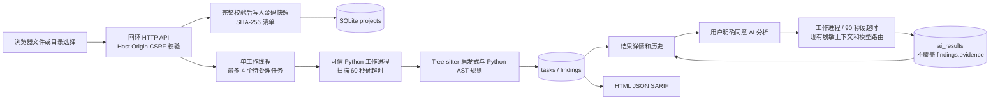
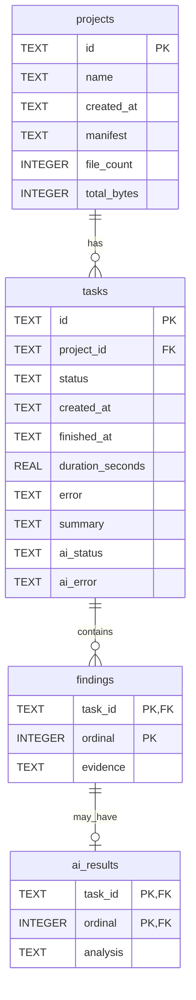

# 源代码安全检测系统需求与设计

本说明覆盖现有 AI-Code-Audit 仓库内新增的 Python 本地毕业设计业务流程，
不替代既有多语言 CLI，不修改其他套件仓库。使用者是具备源码使用权限的本机
操作人员。项目源码和检测结果都留在选定的数据目录内；AI 为明确选择的辅助步骤。

## 技术规格与需求

| 编号 | 需求 | 当前实现与边界 |
|---|---|---|
| R01 | 选择文件/目录/ZIP | 浏览器 File API；目录仅选择 Python；服务端再次校验 |
| R02 | 有限安全导入 | UTF-8 .py；100 文件、512 KiB/文件、8 MiB/项目、12 MiB 请求 |
| R03 | 静态安全检测 | 复用 Tree-sitter 共现启发式，补充 Python AST 五类风险模式 |
| R04 | 可追踪任务 | SQLite；queued/running/completed/failed/interrupted |
| R05 | 可选 AI 分析 | 现有 FindingTriageReviewer 和 shared-llm-core；最多 20 项 |
| R06 | 结果与历史 | 项目列表、任务列表、等级筛选、证据展开和修复建议 |
| R07 | 可移植报告 | HTML/JSON/SARIF；实际查询持久化任务，不生成模拟数据 |
| R08 | 故障保全 | 子进程硬超时；AI 失败保留静态结果；重启恢复未完成状态 |
| R09 | 可复现安装 | 30 个 wheel，版本和 SHA-256 锁定；隔离离线安装已验证 |

Python 包 0.6.0、TypeScript CLI 包 0.5.0 保持原版本。Web 使用 Python 标准库
HTTPServer、ThreadPoolExecutor、SQLite；前端为产品内静态 HTML/CSS/JavaScript。
没有替换已有前端框架，原 TypeScript 组件属于 CLI；套件 web-ui 独立仓未改动。
新增业务层没有增加生产依赖。标准库服务只用于本机回环演示，不承诺公网服务能力。

## 架构与业务流程

导入创建项目快照，扫描另行创建任务；同一项目可以有多次扫描。任务状态和 AI
状态分离，AI 不可用并不把成功的静态任务改成失败。任务扫描前重新验证快照文件
集合、大小与摘要。队列只有一个工作线程，最多四个等待/执行作业。重启时旧的
queued/running 静态任务记为 interrupted，AI 作业记为 unavailable，可重新创建
扫描或重试 AI。服务运行期间持有数据目录锁，禁止两个服务误恢复彼此的任务。

## 静态规则与证据

| 规则 | 风险 | 判定范围与修复方向 |
|---|---|---|
| CG-PY-001 | CWE-78 命令注入 | os.system/popen、部分 subprocess shell；建议参数数组/白名单 |
| CG-PY-002 | CWE-89 SQL 注入 | execute 等第一参数直接拼接、f-string、format；建议参数绑定 |
| CG-PY-003 | CWE-502 反序列化 | pickle/dill/marshal 对象加载、无 SafeLoader 的 yaml.load |
| CG-PY-004 | CWE-95 动态执行 | eval/exec 调用；建议明确解析器，字面量用 literal_eval |
| CG-PY-005 | CWE-798 硬编码凭据 | 敏感赋值目标的字符串常量；隐藏值，建议外部管理与轮换 |
| 004-phase2-taint | 共现潜在风险 | 既有输入/sink 共现规则；不证明数据流，medium/0.5 |

补充规则的严重度通常为 high、置信度 0.7，代表需优先复核的候选问题，不能解释
为 70% 的统计正确概率。每项发现含 source=004、稳定规则、相对路径、行列、
原始检测依据、建议及 verification=unverified。AST 列号基于 UTF-8 字节偏移，
非 ASCII 行不能直接当字符位置。补充规则和启发式在同位置命中时保留补充证据，
避免重复计数；这里的过滤只影响新 Web 扫描，不改变已有 CLI。

当前 AST 不做完整作用域、变量追踪或跨文件数据流证明，导入别名遇到重新赋值/
遮蔽也可能误判。检测规则编号用于风险归类，是否构成可利用漏洞必须人工确认。

## 数据库设计

数据库为数据目录下 `audit.sqlite3`，schema user_version=1，使用 SQLite 外键和
参数绑定。每次操作独立连接，写入事务提交或回滚；不自动覆盖不兼容版本数据库。

manifest 保存每个相对路径、规范化源码字节数与 SHA-256；UTF-8 BOM 在写入快照
时移除。findings.evidence 为每项完整静态发现的 JSON，扫描完成时一次事务写入。
ai_results.analysis 存储模型状态、推断、建议、模型标识、令牌计数或安全错误描述。
复合外键保证 AI 和对应任务发现的明确关联。任务详情读取时组合两者，数据库里的
静态 JSON 不被 AI 改写。只读导出使用同一查询数据源。

## API 接口

| 方法 / 路径 | 输入或输出 | 状态 |
|---|---|---|
| GET /api/session | 本次进程随机 CSRF token、限制与本地模式 | 200 |
| GET /api/projects | 项目概要数组 | 200 |
| POST /api/projects | name、files 或 zip_base64；返回项目与 manifest | 201 |
| GET /api/tasks | 任务概要、AI 状态与错误 | 200 |
| POST /api/tasks | project_id；返回已入队任务 | 202 |
| GET /api/tasks/{id} | task 与 envelope、按序关联的 AI 结果 | 200 |
| POST /api/tasks/{id}/ai | consent=true；返回 AI 入队状态 | 202 |
| GET /api/tasks/{id}/report.html | 完整 HTML 附件 | 200 |
| GET /api/tasks/{id}/report.json | 持久化任务 JSON 附件 | 200 |
| GET /api/tasks/{id}/report.sarif | 现有 SARIF 导出器生成附件 | 200 |

POST 使用 application/json，唯一 Content-Length，X-Audit-Token 请求头。每个
files 条目为 `{path: 相对路径, content_base64: 文件字节的 Base64}`。ZIP 和 files
不能同时提供。错误状态包括 400 输入无效、403 来源/token 拒绝、404 不存在、
408 读取超时、409 队列/状态/容量冲突、413 超大请求、415 格式不支持、500 存储
错误和 503 HTTP 并发占满。输入不允许指定服务端任意目录或远程 URL。

## 安全与资源边界

拒绝绝对路径、..、非规范路径、反斜杠、Windows 保留设备名/ADS、隐藏目录、
大小写重复及文件/目录冲突；ZIP 最多 200 条目、100 文件，拒绝符号链接/特殊
文件、加密文件、解压大小超限、压缩比超过 100。没有调用 extractall。
一次完整校验后才写源码；临时目录只处理本次导入，不覆盖现有项目。

仅监听 127.0.0.1；校验 Host 与 Origin；不开放 CORS；POST 使用随机 token；
HTML 报告进行转义，界面使用 textContent 和 DOM 节点；设置 CSP、nosniff、
frame-ancestors 与 no-store。HTTP 最多 8 个处理线程、套接字超时 10 秒。
每目录最多 30 项目/200 历史任务，每次结果上限 2000 发现/8 MiB。
Python 工作进程不执行上传代码，也不调用外部扫描子进程；超时可终止直接工作
进程。没有验证操作系统级内存上限或完整出站网络隔离，不把进程分离称为安全沙箱。

模型仅在明确同意后接收有限脱敏上下文，待审计代码作为不可信文本包装。Web
路由显式关闭原始提示词/响应审计，不记录密钥与源码；错误不输出 provider 原文。
提示注入防护只能降低风险，真实对抗效果仍需具体模型实测。服务端提供者配置
不能由上传代码或 API 请求更改。模型返回值不执行，confirmed 只表示 AI 推断。
