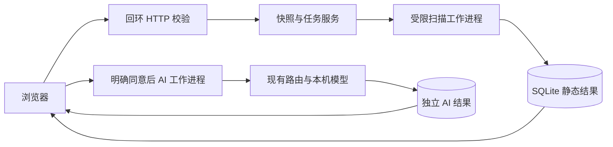
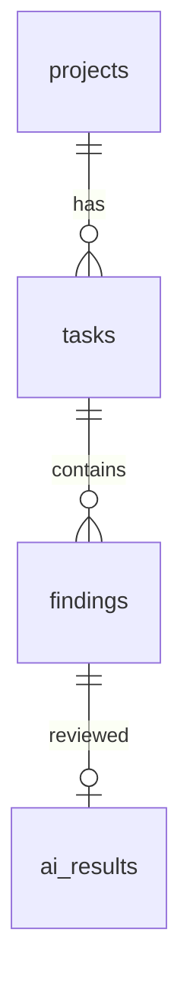
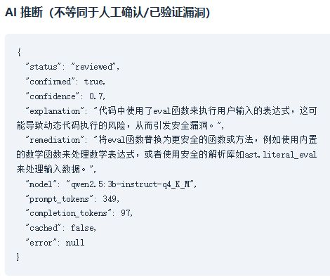

# 基于 Python 与大语言模型的源代码安全检测系统设计与实现

计算机应用技术专业毕业设计论文通用初稿

版本日期：2026 年 10 月 9 日。学校格式、学生信息和指导教师信息待补充。
本文依据真实实现与本机实验编写，检测指标仅适用于所述受控样本。

## 摘要

源代码安全检查需要同时解决风险定位、结果保存和人工理解的问题。针对已有
AI-Code-Audit 命令行项目缺少完整本地业务界面的情况，本文设计并实现了一套
基于 Python 与大语言模型的源代码安全检测系统。系统复用已有 Tree-sitter
扫描和模型路由，在 Python 抽象语法树上补充命令注入、SQL 注入、不安全反序列化、
动态代码执行及硬编码凭据五类风险模式。浏览器支持文件、目录及 ZIP 导入，服务端
校验路径、数量与大小后建立源码快照，通过受限工作进程执行扫描，使用 SQLite
关联保存项目、任务、静态发现及 AI 推断。用户明确同意后，模型接收有限脱敏代码
上下文并提供解释与建议，模型失败时系统保留静态证据。系统支持 HTML、JSON 和
SARIF 报告导出。20 个手工标注合成样本的三轮实验中，静态检测的 Precision 与
Recall 均为 80%；本机 Qwen 3B 指令模型完成 30 次真实复核，评价过滤后的指标没有
变化。结果表明本版本可以完成本地安全审查业务闭环，但规则仍存在变量追踪不足
等局限，AI 建议需要人工核对，实验不能推导真实项目的总体安全水平。

关键词：源代码安全；Python；抽象语法树；大语言模型；SQLite

## Abstract

This project extends the existing AI-Code-Audit command-line scanner with a local
source review workflow. Python AST patterns cover five categories of potential
security risks. Validated source snapshots are scanned in bounded worker processes.
SQLite stores projects, tasks, static findings and separate AI reviews. An optional
local language model explains redacted evidence after explicit user consent. Static
results remain available when the model fails. Reports can be exported as HTML,
JSON and SARIF. Three runs on 20 manually labelled synthetic samples yielded 80%
precision and 80% recall. Thirty real reviews by a local Qwen instruction model
did not change these metrics under the stated filtering policy. The implementation
supports a reproducible local demonstration, while its heuristic coverage and small
evaluation set limit conclusions about real-world accuracy.

Keywords: source code security; Python; abstract syntax tree; language model; SQLite

## 第一章 绪论

### 1.1 研究背景与问题

Python 应用经常调用系统命令、数据库或数据解析库。当外部输入进入危险函数、
查询语句采用字符串拼接或者程序保存敏感凭据时，开发人员需要检查调用位置和
输入约束。MITRE 的 CWE 条目分别描述命令注入、SQL 注入、不可信反序列化与
硬编码凭据等弱点 [4-7]。这些分类为检测结果提供一致的风险名称，但一个函数
调用模式本身不能证明漏洞可利用。

现有项目已经能够从命令行扫描仓库、输出发现并调用模型复核，却没有覆盖文件
导入、历史查询、可视化详情和本地部署的一体化流程。本毕业设计围绕这些实际
缺口展开，目标是让有源码使用权限的操作人员完成可重复的安全审查。系统的输出
是带证据的潜在风险，最终是否修复仍由开发者结合业务决定。

### 1.2 研究内容与实现方法

本设计先审计已有代码并运行基线测试，再补充必要功能，避免替换已经可用的扫描
与模型接口。系统选择本地单用户范围，以 Python 标准库实现 HTTP 服务与任务管理，
使用 SQLite 保存状态。实验采用只解析、不执行的合成代码，将静态结果和 AI 推断
分别保存，并在相同样本上比较二者的候选筛选效果。

本文关注工程可靠性：导入失败不能留下成功项目，扫描失败不能被展示成零发现，
模型超时不能丢失静态报告，报告不能执行上传文本中的 HTML。公网多用户、自动
修复执行和完整污点分析超出本版范围。

### 1.3 论文结构

第二章说明使用的技术；第三章定义需求与边界；第四章说明总体架构和数据关系；
第五章结合实际代码说明实现；第六章记录测试与实验；第七章讨论结论和改进方向。
附录提供核心文件索引与复现实验入口。

## 第二章 相关技术介绍

### 2.1 Python AST 与 Tree-sitter

Python 的 ast 模块将源码解析为语法节点，程序可遍历调用、赋值及表达式结构 [1]。
本系统用 ast.parse 读取源码，不导入待检测模块。相较单纯字符串搜索，语法节点
可以排除注释和字符串中的伪调用，并识别部分导入别名。现有 Tree-sitter 扫描器
继续提供源与危险调用共现的启发式发现。共现和 AST 模式都不构成完整数据流证明，
例如先构造 SQL 变量再执行时，当前规则可能漏报。

### 2.2 SQLite 与任务关联

SQLite 适合本机应用的关系存储。Python sqlite3 接口支持参数绑定及事务 [2]。
本设计以任务 ID 和发现序号关联 AI 结果，通过外键约束降低孤立记录风险。
原始静态发现与模型推断分别存储，查询时再组合展示，使模型判断不会替换检测依据。

### 2.3 本地 HTTP 与浏览器界面

浏览器 File API 提供文件和目录选择，静态 JavaScript 使用 JSON 接口导入快照、
创建任务及查询状态。服务只监听回环地址，校验 Host、Origin 与随机请求令牌。
标准库 HTTP 服务满足受限演示需要，但没有账号体系、跨用户授权或公网运维能力。
前端使用 textContent 渲染不可信文本，服务端导出 HTML 时再次转义。

### 2.4 大语言模型辅助复核

模型通过既有 shared-llm-core 网关访问兼容 Chat Completions 的端点。真实验收
使用本机 Ollama 0.40.0 中已有的 qwen2.5:3b-instruct-q4_K_M。模型接收静态发现
及附近有限代码，输出布尔判断、置信分数、解释和修复建议。置信分数是模型自报值，
没有经过概率校准。OWASP 将提示注入列为大语言模型应用风险 [8]；本系统将源码
包装为不可信数据并明确限制模型指令，仍不能保证所有对抗输入都能被识别。

## 第三章 系统需求分析

### 3.1 用户与业务需求

使用者为本机拥有源码使用权限的开发者或演示人员。完整流程为选择代码、导入
快照、创建扫描、查看证据、选择 AI 复核并导出报告。项目与扫描任务分开管理，
同一快照可以重复扫描。用户需要知道任务是等待、运行、完成还是失败，并能够在
重启服务后查询完成任务。模型复核是可选步骤，静态检测无需模型服务。

| 需求 | 实际功能 | 验证依据 |
|---|---|---|
| 文件与项目输入 | .py 文件、目录选择、受限 ZIP | 导入单元与 HTTP 测试 |
| 风险定位 | 五类补充规则及既有启发式 | 正反例、逐例评价 |
| 任务与历史 | 独立静态与 AI 状态 | 真工作进程、重启测试 |
| 辅助解释 | 用户同意、脱敏上下文、真实本机模型 | 网页成功与故障降级 |
| 保存与报告 | SQLite、HTML、JSON、SARIF | 持久化与下载检查 |

### 3.2 非功能需求

系统不执行上传代码，不从输入中接受服务端任意路径或模型配置。每项目最多 100
个 Python 文件，单文件不超过 512 KiB，总源码不超过 8 MiB。HTTP JSON 请求不
超过 12 MiB。服务最多保存 30 个项目和 200 个历史任务，工作队列最多四项，HTTP
并发最多八个处理线程。扫描和 AI 工作进程具有硬超时，避免无限等待。

可复现性要求包括依赖版本与 SHA-256、源码提交哈希、样本版本、模型摘要及实际
测试记录。可维护性要求保留原包和 CLI，新增业务不引入生产框架依赖。

### 3.3 范围与验收口径

系统第一版重点支持 Python 本地演示，上传文件不代表已授权对外扫描。静态发现、
AI 推断、人工确认及已验证漏洞为不同证据状态；本版仅提供前两种。安全验收指
本轮明确覆盖的路径、上传、超时、转义与数据一致性测试通过，不等同完整渗透测试。
学校学术和格式验收另行进行。

## 第四章 系统总体设计

### 4.1 分层架构

系统由浏览器、HTTP 接口、导入与任务服务、扫描工作进程、模型路由及存储组成。
接口层验证来源和请求结构，服务层建立不可直接修改的快照并安排单工作线程，
工作进程读取源码并输出受限 JSON。扫描结果保存后，界面和报告从同一任务记录
取数。AI 请求使用独立工作进程及独立结果表。



图 4-1 实际系统架构。工作进程分离提供超时控制，不是操作系统安全沙箱。

### 4.2 数据库设计

数据库版本 user_version 为 1。projects 保存项目及文件摘要，tasks 保存任务状态
和统计，findings 保存完整静态发现 JSON，ai_results 保存模型复核 JSON。

| 表 | 主键 | 主要字段 | 关联 |
|---|---|---|---|
| projects | id | name、created_at、manifest、file_count、total_bytes | 一个项目多个任务 |
| tasks | id | project_id、status、duration_seconds、summary、ai_status、error | project_id 外键 |
| findings | task_id 与 ordinal | evidence | task_id 外键 |
| ai_results | task_id 与 ordinal | analysis | 发现复合外键 |



图 4-2 实际数据关系。静态结果与 AI 结果分别更新，读取时依据复合键合并。
扫描完成使用事务写入全部发现。导入时先校验所有文件，数据库新增失败则将本次
唯一快照移回临时目录并清理，不删除或覆盖已有项目。

### 4.3 接口与状态设计

GET /api/session 返回本次服务的请求令牌。POST /api/projects 接收项目名称和
Base64 文件列表或 ZIP。POST /api/tasks 接收 project_id。GET /api/tasks 和
GET /api/tasks/{id} 查询历史与详情。POST /api/tasks/{id}/ai 要求 consent=true。
三个报告接口以 report.html、report.json、report.sarif 结尾。

静态状态为 queued、running、completed、failed、interrupted；AI 另有 completed、
partial、unavailable、not_applicable 等状态。重启恢复中断作业，不假装完成。
输入无效、来源拒绝、资源冲突和请求过大分别返回明确的 HTTP 错误；服务不向
界面暴露原始模型异常、密钥或源码日志。

## 第五章 系统详细设计与实现

### 5.1 安全导入和快照

imports.py 拒绝绝对路径、父目录跳转、反斜杠、Windows 设备名与备用数据流，
也拒绝大小写重复和文件目录冲突。UTF-8 BOM 在保存时规范化。ZIP 不使用
extractall，而是逐条检查元数据，拒绝链接、特殊文件、加密内容、超限解压量和
过高压缩比 [3]。完整验证通过后才写入源码。manifest 保存相对路径、字节数及
SHA-256，扫描前重新验证文件集合和摘要。

### 5.2 静态检测与规则

python_security.py 将 AST Call 和 Assign 节点映射到五项稳定规则。SQL 规则
检查直接传入 execute 等函数的 f-string、拼接或 format 表达式；命令规则检查
部分 shell 调用；反序列化规则区分 SafeLoader；动态执行规则命中 eval/exec；
凭据规则只检查敏感赋值目标的字符串常量，并在证据中隐藏值。

| 规则 ID | 类别 | 主要修复方向 |
|---|---|---|
| CG-PY-001 | 命令注入潜在风险 | 参数数组、限定命令与参数 |
| CG-PY-002 | SQL 注入潜在风险 | 数据库参数绑定 |
| CG-PY-003 | 不安全反序列化 | 数据格式或安全 loader |
| CG-PY-004 | 动态代码执行 | 明确解析器、限定字面量 |
| CG-PY-005 | 硬编码凭据 | 外部凭据管理、必要时轮换 |

发现包含相对文件路径、行列、规则、严重度、证据和建议。既有启发式与 AST 在
同一位置命中时，Web 扫描保留较明确的 AST 证据以减少重复；原 CLI 扫描策略保持。
文件解析失败将任务标为 failed，不能当作零发现成功报告。

### 5.3 AI 复核与失败保全

FindingTriageReviewer 构建附近有限代码上下文，并脱敏 API_KEY、password、
secret、passwd、private_key、auth_token 等常见形式。每次最多分析前 20 项发现。
请求温度为 0、最大输出 500 tokens、JSON 对象格式。返回内容需满足布尔判断、
0 至 1 的数值及非空解释和建议。异常只改变 AI 状态，静态任务及发现不变。

Web 显式关闭原始提示词和响应审计。没有执行 AI 修复代码的入口。真实实验中
模型曾针对 eval 给出“参数化查询”建议，虽然 JSON 协议正确，业务建议并不合适，
说明协议校验不能替代语义审查。界面因此标注 AI 推断，并同时展示静态建议。

### 5.4 任务控制与错误处理

Service 使用一个任务线程和有界队列，通过 subprocess.run 的 timeout 限制可信
扫描进程，默认扫描 60 秒、AI 90 秒。超时终止直接工作进程，任务保存错误状态。
本扫描进程不执行上传代码，不启动外部扫描器子进程。数据目录锁防止两个服务
误恢复彼此作业。资源限制减少耗尽风险，但尚无操作系统级内存硬限制。

### 5.5 界面与报告

页面依次展示导入、项目扫描、历史和详情。风险详情包含检测依据、定位、修复
建议及独立模型结果。HTML 报告转义项目名称、证据和模型文本，包含扫描范围、
工具版本、规则集、统计及局限。JSON 保留完整任务，SARIF 复用已有导出模块。



图 5-1 真实界面的模型复核区域。该任务对应 calculator.py 第 6 行的静态发现。
完整业务界面截图随测试报告保留。

### 5.6 独立安装

生产依赖保持既有声明，离线安装包锁定 30 个 wheel 的名称、版本与 SHA-256。
开发仓库依赖同级 shared-llm-core，交付构建只在生成 wheel 的元数据中将开发
file URL 改为已随包交付的版本约束并重算 RECORD。原始 wheel 保留。安装在新
环境中进行，使用 python -I 从源码目录外启动并核对 site-packages 导入路径，
避免开发目录中的隐含配置掩盖缺失依赖。

## 第六章 系统测试与结果分析

### 6.1 环境和方法

实测环境为 Windows x64、CPython 3.14.6。测试使用绝对解释器、独立临时目录，
保留失败记录及修复后的退出状态。已有 TypeScript 测试为 593 passed、2 skipped。
Python 全量回归及新功能测试的最终计数以随交付测试报告为准，子集不重复相加。
真实浏览器验证了导入、扫描、详情、AI 成功与 HTML 下载；隔离安装验证另外覆盖
JSON、SARIF、历史及重启。

安全测试覆盖路径和 ZIP 攻击输入、请求体上限、来源和令牌、HTML 转义、快照
篡改、真实工作进程超时及数据库失败回滚。测试样例包含写文件 marker，但系统
只读取源码，marker 没有产生。stub 只验证接口契约，真实模型实验单独记录。

### 6.2 标注样本与统计口径

数据集版本为 graduation-python-synthetic-20261009，包含 20 个手工编写样例，
阳性与阴性各 10。每例标明目标规则、预期结果和理由。按目标规则是否命中统计
TP、FP、FN、TN。Precision 用 TP 除以 TP 与 FP 之和，Recall 用 TP 除以 TP 与 FN
之和。标签尚未独立复核，样本不能代表真实项目分布。

### 6.3 静态与 AI 对照实验

静态实验重复三次，结果一致。真实 AI 对照也运行三次，在每次扫描后调用相同
产品复核器，温度为 0、最大 500 tokens、无重试。模型完整摘要为
357c53fb659c5076de1d65ccb0b397446227b71a42be9d1603d46168015c9e4b，服务为
Ollama 0.40.0。两组实验使用相同标注文件及目标规则口径。

| 方式 | TP | FP | FN | TN | Precision | Recall |
|---|---|---|---|---|---|---|
| 静态发现 | 8 | 2 | 2 | 8 | 80% | 80% |
| 静态加 AI 候选过滤 | 8 | 2 | 2 | 8 | 80% | 80% |

AI 评价只在 confirmed=false 时过滤候选，错误时保留候选，静态未命中的样例
不会新增候选。该过滤仅用于实验，产品始终保留全部静态发现。三次各 10 个有
发现样例需要模型调用，共 30 次成功、0 次失败；无发现样例为 not_applicable。
没有观察到准确率提升，不能宣称 AI 自动减少了误报。

### 6.4 误报 漏报与耗时

两个误报为固定 os.system 命令和常量 eval，两个漏报为 SQL 通过变量传递以及
字典内硬编码凭据。保守规则选择告警，但没有判定输入传播；当前模型也没有排除
两项常量误报。静态引擎首轮平均每例 0.001694 秒，不含进程、数据库与 HTTP。
安装版两个实际任务约 0.676 秒和 0.689 秒，网页演示任务 1.123 秒。
首次真实模型验证包含加载与上下文处理，约 4.355 秒。逐次 AI 时长保存在 JSON，
不能把热模型时延当成所有硬件和冷启动的性能承诺。

### 6.5 测试结论与局限

测试支持本版本完成受限本地业务流程。首次测试发现 SARIF 参数形状错误及
Windows 提前拒绝请求导致连接中断，修复后重新通过。最终检查还补齐了凭据别名
脱敏、非 ASCII 令牌拒绝和数据库插入失败回滚。失败记录没有被改写为成功。
Linux、Docker、远程 CI、公网多用户和完整依赖漏洞审计尚未实测，论文不对其
给出通过结论。

## 第七章 总结与展望

本设计在既有项目内完成源码导入、静态风险检测、任务持久化、可选本地模型复核
与报告导出的业务闭环，保持原 CLI 和接口编号，未增加生产框架依赖。主要工程
结果是明确证据状态、限制输入与工作进程资源，并验证模型成功和失败两条路径。
相同合成样本上的对照实验没有显示 AI 准确率提升，模型解释可辅助理解，但仍
存在建议不准确的问题。

后续工作应优先扩大独立标注语料并加入跨文件数据流与作用域分析，再评估不同
模型和提示词对误报的影响。若转为公网服务，应重新设计认证、授权、操作系统级
资源隔离和部署监控，不能直接开放当前演示服务。学校模板、个人信息和独立学术
验收需要在正式提交前补齐。

## 参考文献

[1] Python Software Foundation. ast — Abstract Syntax Trees [EB/OL].
https://docs.python.org/3/library/ast.html，访问日期 2026-10-09。

[2] Python Software Foundation. sqlite3 — DB-API interface for SQLite databases [EB/OL].
https://docs.python.org/3/library/sqlite3.html，访问日期 2026-10-09。

[3] Python Software Foundation. zipfile — Work with ZIP archives [EB/OL].
https://docs.python.org/3/library/zipfile.html，访问日期 2026-10-09。

[4] MITRE. CWE-78 Improper Neutralization of Special Elements used in an OS Command [EB/OL].
https://cwe.mitre.org/data/definitions/78.html，访问日期 2026-10-09。

[5] MITRE. CWE-89 Improper Neutralization of Special Elements used in an SQL Command [EB/OL].
https://cwe.mitre.org/data/definitions/89.html，访问日期 2026-10-09。

[6] MITRE. CWE-502 Deserialization of Untrusted Data [EB/OL].
https://cwe.mitre.org/data/definitions/502.html，访问日期 2026-10-09。

[7] MITRE. CWE-798 Use of Hard-coded Credentials [EB/OL].
https://cwe.mitre.org/data/definitions/798.html，访问日期 2026-10-09。

[8] OWASP. LLM01 Prompt Injection [EB/OL].
https://genai.owasp.org/llmrisk/llm01-prompt-injection/，访问日期 2026-10-09。

## 致谢

本节由学生补充实际得到的指导和帮助，通用初稿不虚构导师、学校或他人贡献。

## 附录 实现与复现索引

关键代码：python_security.py；web/imports.py；web/service.py；web/store.py；
web/worker.py；web/server.py；web/static/app.js；triage.py；triage_context.py。
建表语句位于 web/store.py，数据库模式版本为 1。核心 API 和字段详见系统设计。

实验入口为 scripts/graduation_eval.py 和 scripts/graduation_ai_eval.py。标注文件
为 benchmarks/graduation/labels.json，逐例机器记录为 docs/tests 下两份评价 JSON。
部署、失败记录及命令详见同目录部署手册与 graduation-test-report.md。

受控示例仅供解析：

```python
# 修复前：输入进入动态代码执行
value = input()
eval(value)

# 修复后：仅当业务需要解析字面量时使用
import ast
value = input()
ast.literal_eval(value)
```

literal_eval 同样需要业务输入大小限制，不适用于任意数学表达式。实际应用的
修复方案须依据业务语义选择，不能直接执行模型给出的代码。
